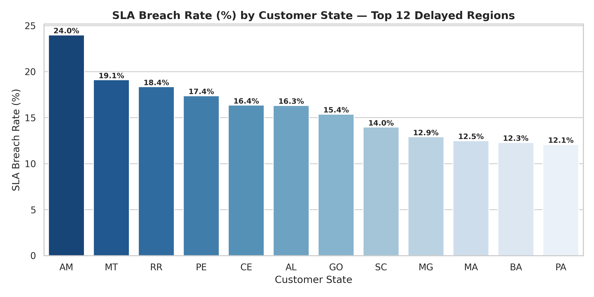
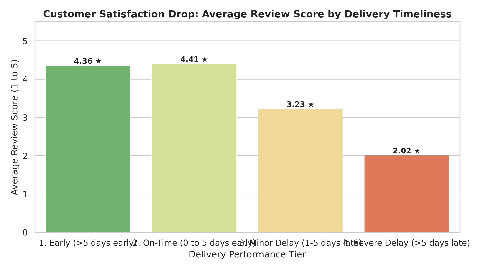
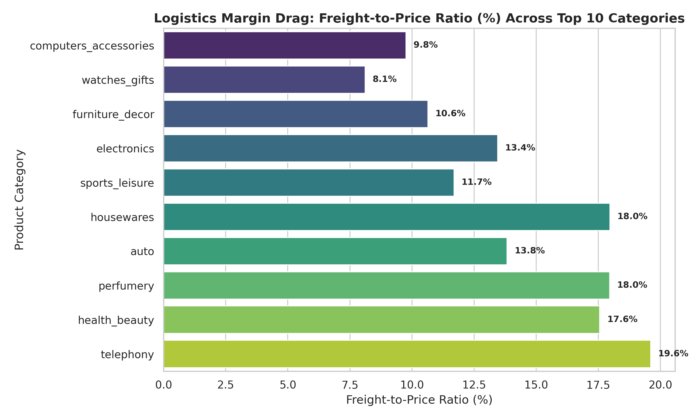

# Olist E-Commerce Logistics & Analytics Pipeline

End-to-end analytics engineering and supply chain analysis of the Brazilian Olist e-commerce dataset using Python, DuckDB, SQL, and Power BI.

---

## Project Overview
This project analyzes 100K+ e-commerce orders to identify logistical bottlenecks, state-wise delivery SLA breaches, freight-to-price cost burdens, and the direct impact of delivery delays on customer satisfaction.

## Project Structure
- `data/` — Relational Olist datasets (orders, order_items, customers, sellers, products, reviews).
- `sql/` — Production-ready DuckDB SQL queries covering fulfillment turnaround times, SLA breaches, and review score degradation.
- `scripts/` — End-to-end Python pipeline (`run_olist_pipeline.py`) that ingests raw CSVs into DuckDB and builds the denormalized Power BI dataset.
- `outputs/` — Pre-generated summary CSVs and high-resolution Matplotlib/Seaborn charts.
- `powerbi/` — Master model CSV (`olist_powerbi_master_model.csv`) and setup guide with DAX formulas (`PowerBI_Setup_and_DAX_Guide.md`).

---

## Key Business Insights & Visuals

1. **SLA Breaches by State:** Delivery delays heavily concentrate in specific northern and remote geographic regions, severely impacting customer trust.


2. **Review Score Degradation:** Customer review scores drop off sharply the moment an order crosses its estimated delivery date by more than 2 days.


3. **Freight-to-Price Ratio:** Certain heavy or low-cost product categories suffer from disproportionately high freight-to-price ratios, acting as a deterrent for buyers.


---

## How to Reproduce or Run
1. **Clone the Repository:**
   ```bash
   git clone [https://github.com/VinithaKamidi/olist-ecommerce-analytics.git](https://github.com/VinithaKamidi/olist-ecommerce-analytics.git)
